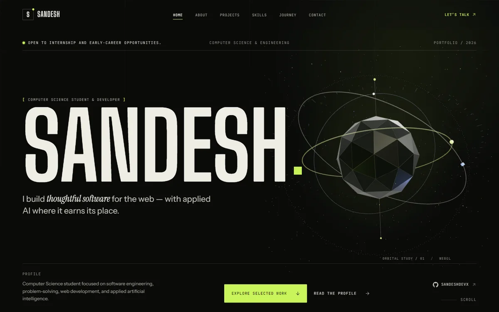

# Sandesh — Developer Portfolio

A production-oriented static portfolio for Sandesh, a Computer Science and Engineering student at New Horizon College of Engineering. The site presents selected projects, technical skills, education, certifications and a direct contact route through a dark editorial interface with a custom Three.js orbital hero.

> **Deployment status:** not deployed yet. Configure the production URL with `SITE_URL` before publishing so canonical URLs, Open Graph metadata, `robots.txt` and the sitemap point to the real domain.



## Highlights

- Editorial visual system built around Big Shoulders Display, Instrument Sans, Instrument Serif and JetBrains Mono.
- Lazy-loaded, custom Three.js hero scene with pointer response, scroll response and a static CSS fallback.
- GSAP/ScrollTrigger reveals with a reduced-motion path that serves a calm, fully visible experience.
- All content sourced from one typed file: `src/data/portfolio.ts`.
- Real project detail expansion, mobile navigation with focus trapping, scroll spy, copy-email support when configured and back-to-top behaviour.
- Static Astro output with sitemap, structured data, generated OG artwork and PWA icons.
- Responsive at 1440, 1024, 768, 390 and 360 px; no horizontal page overflow at tested widths.
- No fabricated experience, project links, metrics, testimonials or contact details.

## Stack

| Area | Technology |
| --- | --- |
| Framework | Astro 7, static output |
| Language | TypeScript |
| 3D | Three.js |
| Motion | GSAP + ScrollTrigger |
| Icons | `@lucide/astro` plus custom brand glyphs |
| Fonts | Self-hosted Fontsource packages |
| Tooling | Sharp for local icon/OG asset generation |
| Deployment target | Cloudflare Pages |

## Quick start

Requirements: Node.js `>=22.23.4` (the version is declared in `package.json`).

```sh
npm install
npm run dev
```

The local development server is normally available at `http://localhost:4321/`.

### Commands

| Command | Purpose |
| --- | --- |
| `npm run dev` | Start the Astro development server |
| `npm run check` | Run `astro check` for Astro/TypeScript diagnostics |
| `npm run build` | Generate the static production site in `dist/` |
| `npm run preview` | Serve the production build locally |
| `npm run assets` | Regenerate favicon and app icons from `public/favicon.svg` |

## Project structure

```text
proto-proxima/
├── docs/
│   ├── ARCHITECTURE.md
│   ├── AAT-1-REPORT.md
│   └── screenshots/
├── public/                  # favicon, app icons, manifest, og.png
├── scripts/
│   └── generate-icons.mjs
├── src/
│   ├── components/
│   │   ├── layout/          # Navbar, Footer
│   │   ├── sections/        # Hero, About, Projects, Skills, Journey, Contact
│   │   ├── three/           # HeroScene.ts
│   │   └── ui/              # project cards, buttons, shared primitives
│   ├── data/portfolio.ts    # typed content source
│   ├── layouts/BaseLayout.astro
│   ├── pages/               # home, 404, OG artwork, robots.txt
│   ├── scripts/             # site interactions and GSAP motion
│   ├── styles/              # design tokens, global rules, keyframes
│   └── types/               # ambient module declarations
├── astro.config.mjs
├── package.json
└── tsconfig.json
```

## Content and configuration

### One content source

Edit `src/data/portfolio.ts` to update identity, education, skills, certifications, projects, journey entries, navigation, availability and SEO copy. Components derive counts, labels and metadata from this file.

### Contact channels

The contact block currently contains:

```ts
const contact = {
  email: '',
  github: 'https://github.com/sandeshdevx',
  githubLabel: 'sandeshdevx',
  linkedin: '',
  resume: '',
};
```

Empty values are intentionally hidden. Adding a non-empty email, LinkedIn URL or résumé path automatically enables the matching UI. The GitHub profile is the only confirmed public channel in this build.

### Production URL and SEO

The site URL defaults to `https://example.com` so the static build remains deterministic. Set the real origin for production:

```sh
# macOS/Linux
SITE_URL=https://your-domain.example npm run build
```

```powershell
# PowerShell
$env:SITE_URL="https://your-domain.example"; npm run build
```

`SITE_URL` drives the canonical URL, Open Graph/Twitter image URL, JSON-LD `Person.url`, `robots.txt` sitemap URL and generated sitemap entries.

### OG artwork

`public/og.png` is a 1200×630 capture of the static `/og` route. To regenerate it after changing the design or copy, start the preview server and use a browser capture at `http://127.0.0.1:4321/og` with a 1200×630 viewport. Keep the file at `public/og.png`.

## Cloudflare Pages

Recommended project settings:

| Setting | Value |
| --- | --- |
| Framework preset | Astro |
| Build command | `npm run build` |
| Build output directory | `dist` |
| Production branch | `main` |
| Node version | `22.23.4` or newer |
| Environment variable | `SITE_URL=https://your-production-domain` |

No adapter, database, runtime secret or server-side environment is required. The generated output is fully static.

## Quality checks

Run before deployment:

```sh
npm run check
npm run build
npm run preview
```

Verified in this build:

- `npm run check`: 0 errors, 0 warnings, 0 hints.
- `npm run build`: 3 static pages generated successfully.
- No console exceptions or failed local requests in browser QA.
- Three.js scene initialised at all tested motion-enabled widths.
- Reduced motion used the static fallback and kept content visible.
- Direct hash navigation, scroll spy, mobile menu, Escape-to-close, project case-study details and back-to-top behaved correctly.
- All local asset routes and hash targets resolved in QA.

The production build reports one non-blocking warning: the lazy Three.js chunk is larger than 500 kB. It is loaded only after the page load and only when WebGL is available and reduced motion is off.

## Documentation

- [Architecture](docs/ARCHITECTURE.md)
- [AAT-1 implementation report](docs/AAT-1-REPORT.md)

## Content integrity

The site intentionally limits project copy to confirmed scope. CURIOnEST is presented as a documented product concept, and Zenith carries a clear note that it is a support tool rather than a diagnostic or medical service. Project visuals are labelled as generative visual studies, not screenshots. Add links, metrics and deeper implementation details only when they can be verified.
