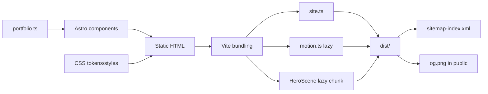
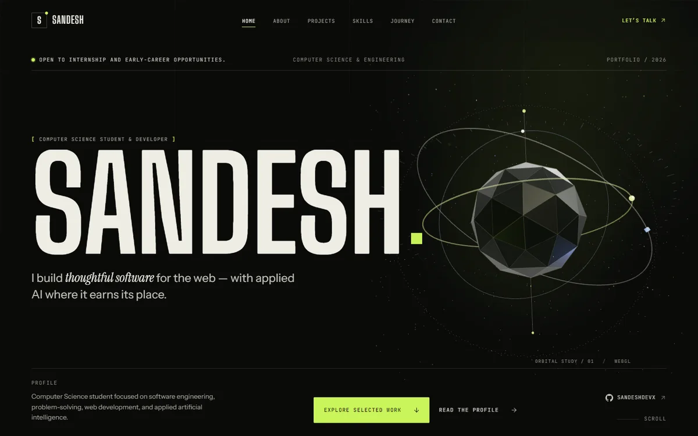
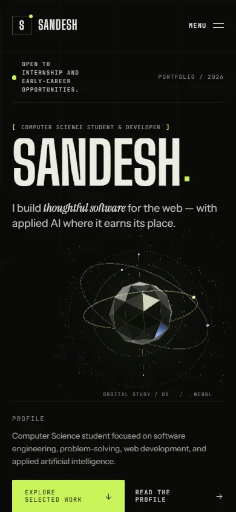
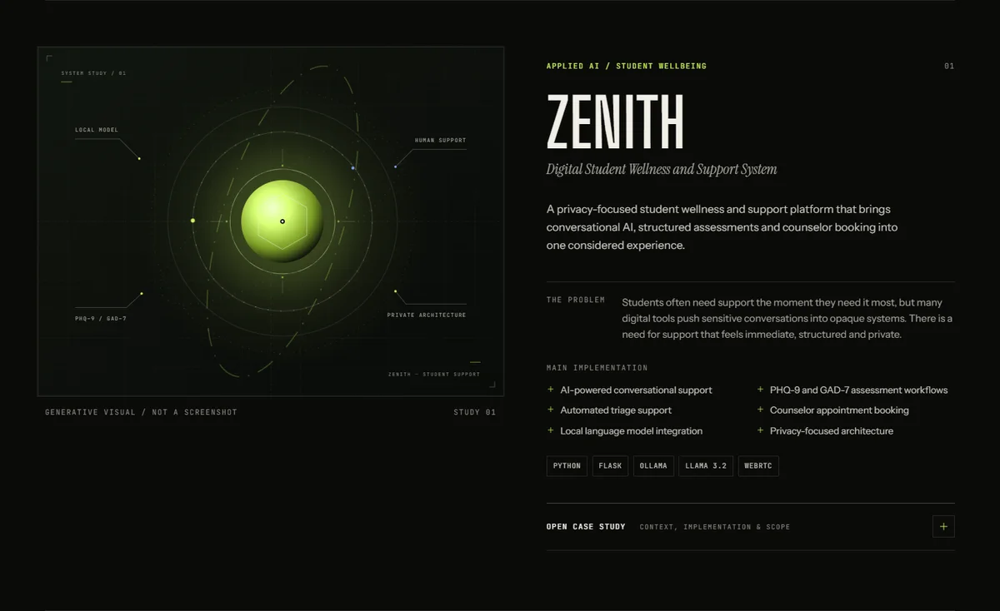
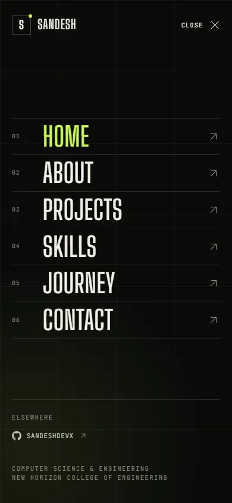

# AAT-1 Implementation Report

**Project:** Sandesh — Developer Portfolio

**Location:** `portfolio/`

**Implementation date:** 13 November 2026

**Repository:** [github.com/sandeshdevx/portfolio](https://github.com/sandeshdevx/portfolio)  
**Deployment status:** not deployed; production URL intentionally unset.

## 1. Executive summary

A complete static developer portfolio was implemented with Astro 7, TypeScript, Three.js, GSAP and a custom design system. The site presents only verified information: Sandesh's Computer Science education at New Horizon College of Engineering, a 9.12 CGPA, two OCI 2025 certifications, and three confirmed projects (Zenith, Smart Health Tracker and CURIOnEST).

The final build is fully static with a custom orbital hero, editorial project presentation, responsive navigation, accessible motion fallbacks, generated Open Graph artwork and icons, sitemap and structured data. It is ready for a Cloudflare Pages deployment once the production domain and any missing contact channels are supplied.

## 2. Scope and constraints

### In scope

- Single-page portfolio with Home, About, Projects, Skills, Journey and Contact sections.
- Premium visual direction using the approved charcoal / off-white / lime / blue palette.
- Three.js hero scene with a static fallback.
- GSAP motion with reduced-motion support.
- Mobile navigation, scroll spy, expandable case studies, back-to-top and hash navigation.
- SEO metadata, Open Graph image, favicon set, manifest, robots and sitemap.
- Documentation and browser-based visual/interaction QA.
- Cloudflare Pages deployment readiness.

### Constraints and content rules

- Do not invent project links, experience, testimonials, metrics or contact details.
- Use the verified GitHub profile (`https://github.com/sandeshdevx`) as the only public contact channel available in the data.
- Hide email, LinkedIn and résumé UI while their values are empty.
- Present generative visuals as concept studies, not screenshots.
- Keep CURIOnEST scope deliberately limited until more technical documentation exists.
- Keep Zenith's medical boundary visible: support tool, not a diagnostic service.
- No backend, database, authentication, analytics, cookies or form endpoint.

## 3. Design direction

The visual system is a dark editorial engineering aesthetic rather than a conventional SaaS portfolio page.

| Element | Decision |
| --- | --- |
| Ground | Deep charcoal `#0a0b09` with subtle warm grain and vertical guides |
| Primary ink | Warm off-white `#f1efe6` |
| Accent | Electric lime `#c9f45a` |
| Secondary accent | Restrained blue `#7f9fff` |
| Display type | Big Shoulders Display for large compressed headlines |
| Body type | Instrument Sans for readable interface copy |
| Editorial accent | Instrument Serif italic for emphasis and project taglines |
| Utility type | JetBrains Mono for indices, labels, metadata and controls |
| Layout | 1440px container, fluid gutters, editorial rules and visible grid language |
| Motion | Slow reveals, orbital drift, restrained parallax and a single responsive hero scene |

The result is intentionally asymmetrical: oversized names and section headings, technical annotation, low-contrast grid lines and a focused lime accent. Project visuals were designed as bespoke SVG studies so each project has a distinct visual identity without pretending to be a product screenshot.

## 4. Information architecture

```text
Home
├── Hero
│   ├── Availability and discipline metadata
│   ├── Name, statement, profile summary
│   ├── Orbital scene
│   └── Project/profile actions, GitHub, scroll cue
├── 02 About
│   ├── Profile card
│   ├── Biography and signature
│   ├── Three principles
│   └── CGPA, project, certification and skill-area stats
├── 03 Selected work
│   ├── Zenith
│   ├── Smart Health Tracker
│   └── CURIOnEST
│       └── Expandable context, implementation, stack and boundary/scope notes
├── 04 Technical index
│   ├── Practice statement
│   ├── Six-area orbital diagram
│   └── Six skill groups with technology chips
├── 05 Journey
│   ├── Education
│   ├── Two certifications
│   ├── Three project entries linking back to case studies
│   └── Ongoing learning
├── 06 Contact
│   ├── Availability
│   ├── Direct GitHub channel
│   └── Back-to-beginning action
└── Footer
    ├── Identity and tagline
    ├── Section navigation
    ├── GitHub / availability
    └── Back-to-top
```

Navigation is section-aware and uses `aria-current="location"`. The desktop navigation becomes a full-screen dialog below 1025px. The 404 route retains the same brand language and offers a return home and a project shortcut.

## 5. Technical architecture

### Rendering

- Astro static output; no adapter.
- `build.format: 'directory'` and `trailingSlash: 'never'`.
- All content is rendered at build time from `src/data/portfolio.ts`.
- The only client-side data dependency is no data at all; interactions operate on server-rendered markup.

### Main layers

| Layer | Files | Responsibility |
| --- | --- | --- |
| Shell | `src/layouts/BaseLayout.astro` | Document metadata, fonts, nav/footer and global interaction script |
| Content | `src/data/portfolio.ts` | Typed source of truth and derived contact flags |
| Sections | `src/components/sections/*` | Page narrative and section-specific layout |
| UI | `src/components/ui/*` | Reusable buttons, headings, social links, project cards, visuals, glyphs |
| 3D | `src/components/three/HeroScene.ts` | Lazy WebGL orbital study and lifecycle |
| Motion | `src/scripts/motion.ts` | GSAP/ScrollTrigger reveals and parallax |
| Interaction | `src/scripts/site.ts` | Header, menu, scroll spy, hash scrolling, back-to-top, copy email |
| Assets | `public/`, `scripts/generate-icons.mjs` | Icons, manifest, OG image |
| Routes | `src/pages/*` | Home, 404, OG artwork, robots |

### Build flow



### Component contracts

- `SectionHeading` requires `index` and `label`; supports `id`, `align="split"` and an optional intro slot.
- `ProjectCard` requires a typed `Project`; `flip` controls the alternating media/content layout.
- `ProjectVisual` accepts a `visual` variant (`zenith`, `tracker`, `nest`) and project name.
- `Button` supports link or button rendering, primary/ghost/text variants and directional arrows.
- `SocialLinks` supports footer, inline and stack variants from the filtered `socialLinks` array.
- `BrandGlyph` provides inline GitHub/LinkedIn glyphs without loading a brand icon package.

## 6. Content and data decisions

### Verified content used

- Name: Sandesh.
- Role: Computer Science student / developer.
- Education: B.E. Computer Science and Engineering, New Horizon College of Engineering.
- CGPA: 9.12.
- Certifications: OCI 2025 Certified Generative AI Professional; OCI 2025 Certified Foundations Associate.
- Skills: Java, Python, HTML5, CSS3, JavaScript, Tailwind CSS, Flask, SQLite, MySQL, generative AI/LLMs, RAG, Ollama, LangChain, FAISS, Git/GitHub, VS Code, IntelliJ IDEA.
- Projects: Zenith, Smart Health Tracker, CURIOnEST.
- Public channel: `https://github.com/sandeshdevx`.

### Deliberate omissions

- Email, LinkedIn and résumé values are empty. Their UI is conditionally hidden rather than filled with plausible placeholder addresses.
- No project GitHub or demo links are present because none were confirmed.
- No employment history, testimonials or quantified product results are claimed.
- CURIOnEST has no invented stack or implementation metrics.
- Zenith's generative visual is explicitly labelled as a study, and its medical boundary is stated in the expandable case study.

### Content editing path

All public copy, certifications, navigation and contact configuration live in `src/data/portfolio.ts`. Adding a non-empty email, LinkedIn URL or résumé path automatically enables the relevant UI in the navbar, contact section and footer. The site URL is controlled separately through `SITE_URL`.

## 7. Motion, 3D and progressive enhancement

### Three.js scene

- Imported only after page load via `requestIdleCallback` or a timeout fallback.
- Skipped entirely when `prefers-reduced-motion: reduce` matches.
- Skipped when WebGL/WebGL2 context creation fails.
- Uses no external models, textures or network requests.
- Scene-ready state adds `.scene-ready` to the document, fades the canvas in and dims the static fallback.
- On failure, the canvas is marked failed, a warning is logged and the static orbital fallback remains.
- Cleans up the animation frame, observers, listeners, renderer, materials and geometries on `pagehide`.

### Motion

- Hero entrance uses CSS keyframes.
- GSAP reveals use `once: true` to avoid repeating content every time it re-enters the viewport.
- Project visuals receive subtle scrubbed parallax.
- Project case-study opening triggers a ScrollTrigger refresh so the expanded layout remains correct.
- Reduced motion disables the dynamic import of `motion.ts`, collapses CSS animation durations and turns off the hero scene.
- Direct hash links are corrected after fonts are ready, ensuring `/#projects` and similar deep links land on the intended section rather than leaving the user at the top.

## 8. Accessibility and responsive verification

### Accessibility measures

- Skip link to `main#main`.
- Semantic section headings with `aria-labelledby`.
- Visible `:focus-visible` ring.
- Navigation links expose active state with `aria-current="location"`.
- Mobile menu:
  - `role="dialog"`, `aria-modal="true"`, labelled navigation.
  - `aria-expanded` on the toggle.
  - `inert` on the closed panel and on `main`/footer while open.
  - Focus moves into the panel, is trapped there, and returns to the toggle after Escape or close.
  - Body scroll is locked while open.
- Decorative art uses `aria-hidden="true"`; controls have explicit labels.
- Reduced-motion users receive static artwork and fully visible content.
- Missing contact methods are not rendered as inert or fake controls.

### Browser QA matrix

Measured in Chrome via CDP against the production build served by `astro preview` on 13 November 2026.

| Viewport | Page scroll width | Horizontal page overflow | 3D scene | Console errors | Result |
| --- | ---: | --- | --- | --- | --- |
| 1440 × 900 | 1440 | None | `.scene-ready` | 0 | Pass |
| 1024 × 768 | 1024 | None | `.scene-ready` | 0 | Pass |
| 768 × 900 | 768 | None | `.scene-ready` | 0 | Pass |
| 390 × 844 | 390 | None | `.scene-ready` | 0 | Pass |
| 360 × 800 | 360 | None | `.scene-ready` | 0 | Pass |
| 390 × 844, reduced motion | 390 | None | Static fallback | 0 | Pass |

The marquee track and ambient glow intentionally extend beyond their own boxes, but their containing sections clip them; the document itself does not scroll horizontally.

### Interaction checks

| Check | Observed result |
| --- | --- |
| Direct load of `/#projects` | Scrolled to Projects; active "Projects" link set |
| Navbar Projects click | Smooth scroll to Projects; scroll spy updated |
| Mobile menu open | `aria-expanded=true`, panel visible, `inert=false`, body locked, focus inside |
| Escape from mobile menu | Panel closed, `inert=true`, body unlocked, focus returned to Menu |
| Project case study | `details.open=true`, body height 576px, visible content |
| Back to top | Returned to `scrollY=0` |
| Internal hash targets | 0 broken hash links across 33 links |
| External new-tab links | 0 missing `rel="noopener"` |
| Local assets and routes | `/og.png`, favicons, manifest, robots and sitemap all returned 200 |
| Reduced motion | Scene skipped, fallback displayed, reveal opacity 1, animation duration collapsed |

### Screenshots

| Surface | Evidence |
| --- | --- |
| Desktop homepage |  |
| Mobile homepage |  |
| Project detail |  |
| Mobile navigation |  |

## 9. Performance, SEO, security and deployment

### Performance

- Static HTML with no hydration framework.
- Three.js is a lazy chunk loaded only for eligible visitors.
- No web font CDN, third-party embeds, analytics or cookie banner.
- All project visuals are inline SVG/CSS, avoiding raster image weight.
- Device pixel ratio is capped for the hero renderer.
- One non-blocking build warning: the lazy Three.js chunk exceeds Vite's 500 kB warning threshold. This is accepted because it is post-load, conditional and backed by a static fallback.

### SEO

- Canonical URL built from `SITE_URL`.
- Open Graph and Twitter card metadata with a 1200×630 image.
- Person JSON-LD with education, skills and credentials.
- `/og` is noindex and excluded from the sitemap.
- Sitemap index generated at build time.
- `robots.txt` points to the sitemap.

### Security and privacy

- No forms, uploads, cookies, analytics or backend.
- External links use `target="_blank"` only where appropriate and include `rel="noopener noreferrer"`.
- Contact copy uses the Clipboard API only when an email is configured.
- No secrets or environment variables beyond the optional public `SITE_URL`.

### Deployment readiness

Cloudflare Pages settings:

```text
Build command: npm run build
Build output directory: dist
Node version: 22.23.4+
Environment: SITE_URL=https://<production-domain>
```

Required before launch:

1. Set `SITE_URL` to the production origin.
2. Add any confirmed email, LinkedIn and résumé values, or leave them hidden.
3. Add verified project links when available.
4. Regenerate `public/og.png` if the OG artwork changes.
5. Configure any required response headers at the Cloudflare project level.
6. Re-run `npm run check` and `npm run build`.

## 10. Verification and remaining work

### Commands and results

```text
npm run check
Result: 0 errors, 0 warnings, 0 hints.

npm run build
Result: 3 pages built successfully.
Routes: /index.html, /404.html, /og/index.html, /robots.txt.
Sitemap: sitemap-index.xml created.
Known warning: one lazy chunk larger than 500 kB.
```

### Remaining manual steps

- Deploy to Cloudflare Pages and verify the production domain, SSL, canonical URL and OG preview.
- Test in Safari/Firefox and on a physical mobile device; this QA pass used headless Chrome.
- Revisit visual QA after any content or section additions.
- Add verified project links, email, LinkedIn or résumé if the owner wants them public.
- Consider a small Lighthouse pass once the production URL exists; no performance scores are claimed here.

### Conclusion

The portfolio is implemented, documented and production-buildable. It meets the content-integrity requirement by publishing confirmed information only, keeps missing contact channels hidden, and provides a robust static experience when WebGL or motion is unavailable. The remaining gaps are deliberate inputs—production domain, optional contact channels and optional project links—rather than unfinished core implementation.
