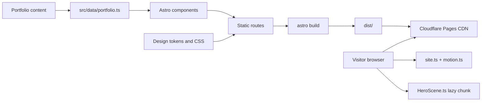
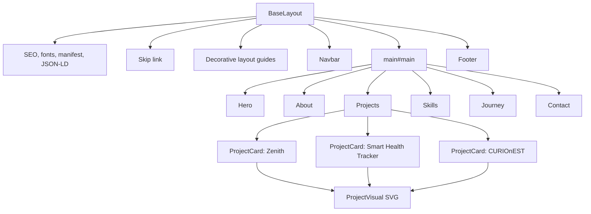
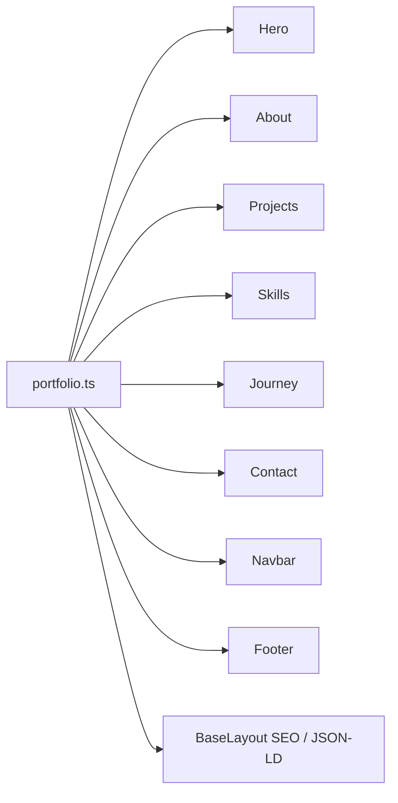
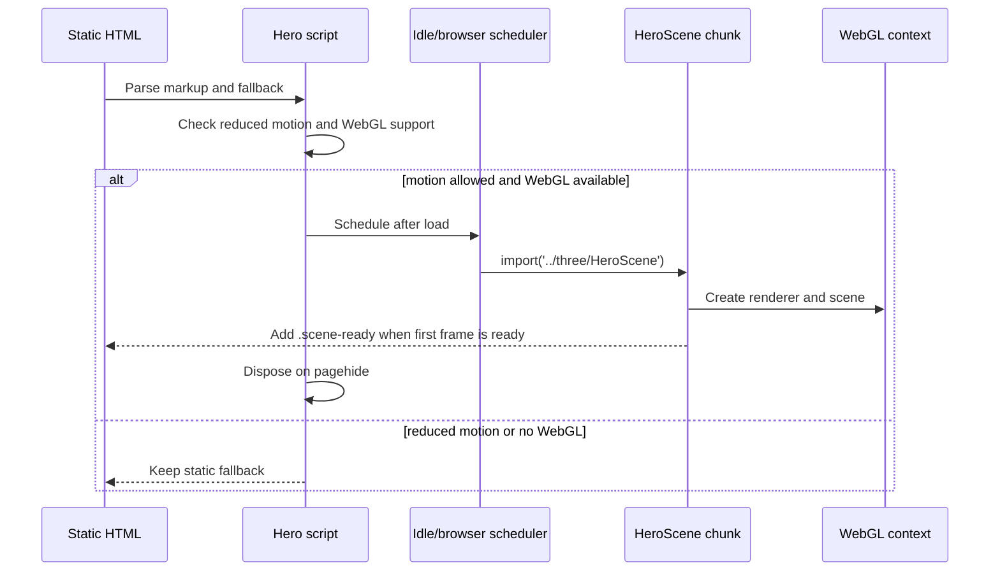
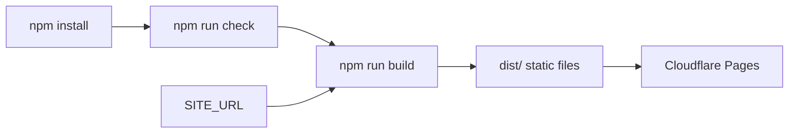
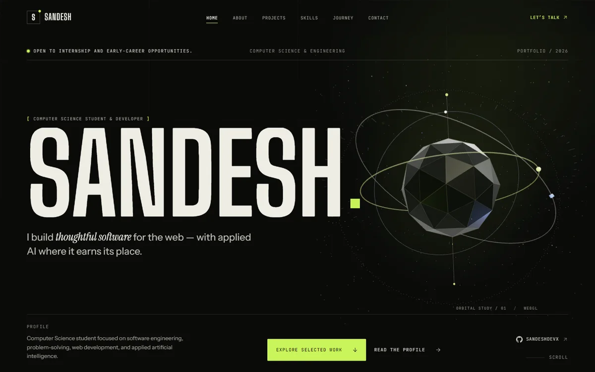
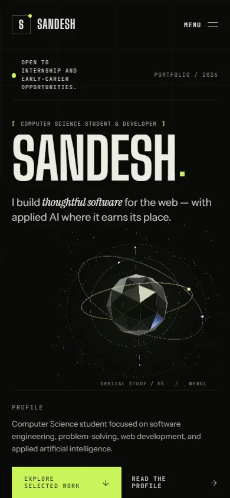
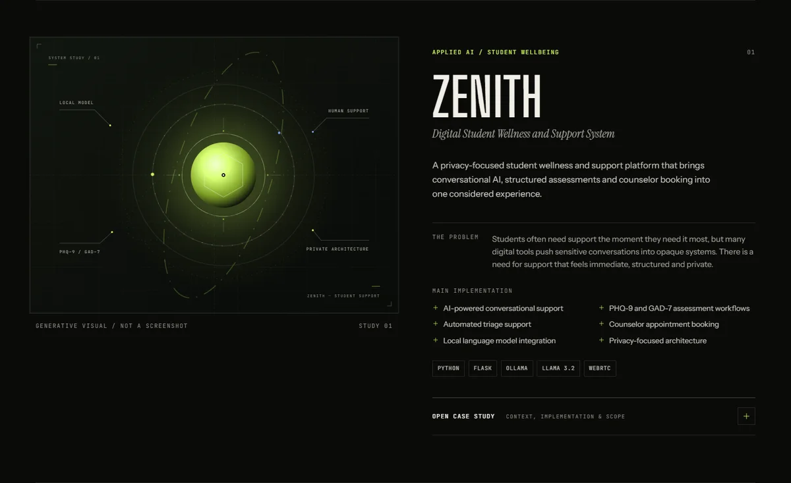
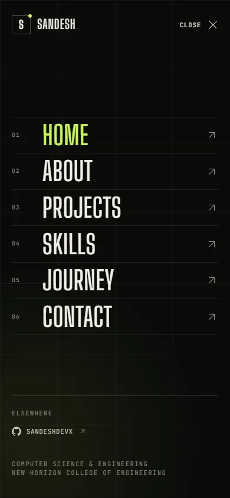

# Architecture

## Overview

This portfolio is a statically generated Astro site. Every route is rendered at build time and deployed as files; there is no runtime server, database, authentication layer or form endpoint. The interface is intentionally progressive: the HTML, typography and generated project artwork work without client-side JavaScript, while interactions and the Three.js hero enhance the experience when JavaScript, motion and WebGL are available.

The build targets Cloudflare Pages and requires no adapter. `SITE_URL` is the only production-specific input.

## System context

## Route map

| Route | Source | Output | Purpose |
| --- | --- | --- | --- |
| `/` | `src/pages/index.astro` | `dist/index.html` | Full one-page portfolio |
| `/404.html` | `src/pages/404.astro` | `dist/404.html` | Branded not-found page |
| `/og` | `src/pages/og.astro` | `dist/og/index.html` | Noindex artwork used to capture the OG image |
| `/robots.txt` | `src/pages/robots.txt.ts` | `dist/robots.txt` | Crawl policy and sitemap location |
| `/sitemap-index.xml` | `@astrojs/sitemap` | `dist/sitemap-index.xml` | Generated sitemap; `/og` excluded |

`astro.config.mjs` uses `trailingSlash: 'never'` and `build.format: 'directory'`. The canonical link is generated from the configured `site` value, not from request headers, because the deployment is static.

## Page composition

The home route composes the sections directly. Shared primitives (`Button`, `SectionHeading`, `SocialLinks`, `BrandGlyph`) keep repeated interaction and visual patterns consistent.

## Content model

`src/data/portfolio.ts` is the public content contract and editing point. It exports typed objects plus derived values:

- `identity`: name, monogram, role, college, CGPA, hero statement, availability, interests, biography and principles.
- `projects`: id, index, name, tagline, category, problem, approach, capabilities, stack, optional links, visual variant, optional boundary/scope notes.
- `skillGroups`: practice areas with captions and technology chips.
- `journey`: education, certifications, projects and ongoing learning.
- `contact`, `socialLinks`: empty channels are filtered out before rendering.
- `seo`, `navigation`, `marquee`.
- Derived flags: `hasEmail`, `hasLinkedIn`, `hasResume`, `hasSocialLinks`; derived `mailtoHref` and `resumeHref`.

Content travels one way: data → server-rendered Astro markup → static HTML. The client does not fetch portfolio content.

## Visual system

The design intentionally avoids generic dashboard conventions. It uses a deep charcoal ground, warm off-white text, an electric-lime accent and a restrained blue secondary.

| Token group | Location | Notes |
| --- | --- | --- |
| Colour | `src/styles/tokens.css` | Background, ink, muted, lime, blue, border and z-index tokens |
| Typography | `src/styles/tokens.css` | Big Shoulders Display, Instrument Sans, Instrument Serif, JetBrains Mono |
| Layout | `src/styles/tokens.css` | 1440px container, fluid gutter, section rhythm, header height |
| Motion | `src/styles/tokens.css` | Shared easing curves and durations |
| Global rules | `src/styles/global.css` | Reset, focus, guides, labels, chips, buttons, skip link |
| Keyframes | `src/styles/animations.css` | Status pulse, hero rise, fade, orbit, marquee, scroll cue |

Fonts are self-hosted through Fontsource packages imported in `BaseLayout.astro` and `og.astro`. Variable Fontsource imports are extensionless (`/wght`, resolved to `/wght.css` by the package export map). `src/types/fontsource.d.ts` supplies the ambient module declarations needed by `astro check`.

## Hero scene

`src/components/sections/Hero.astro` renders a complete static orbital fallback and an empty canvas. `HeroScene.ts` is loaded only when all of these are true:

1. A hero canvas exists.
2. The visitor does not prefer reduced motion.
3. A WebGL or WebGL2 context can be created.

The import is scheduled after page load with `requestIdleCallback` when available, or a short timeout otherwise. This keeps Three.js out of the initial render path.

Scene composition in `HeroScene.ts`:

- Procedural low-poly metallic core with rim lighting.
- Layered orbit rings and small satellites.
- Tick dial and particle field for depth.
- Pointer parallax and scroll-responsive transforms.
- DPR capped for fill-rate control.
- Resize handling through a `ResizeObserver`.
- Cleanup of animation loop, observers, listeners, renderer and materials on `pagehide`.
- Static fallback remains visible at low opacity once the canvas is ready, preserving the composition during load.

The scene has no external textures, models or network requests after its code chunk is loaded. The project visuals below are separate inline SVG studies and are not scene textures.

## Motion and interaction layers

### `src/scripts/site.ts`

Loaded on every page through `BaseLayout.astro`. It handles:

- Sticky header state after scrolling.
- Mobile navigation open/close, `inert` isolation of `main` and footer, body scroll lock, focus movement, Escape-to-close and focus restoration.
- Keyboard focus trap for the open navigation dialog.
- Scroll spy using `IntersectionObserver` on `[data-section]`, with `aria-current="location"`.
- Back-to-top behaviour.
- Optional copy-email status handling.
- Initial hash scrolling after fonts are ready, so direct links such as `/#projects` land correctly even when layout shifts during font loading.

### `src/scripts/motion.ts`

Loaded only on the home page and only when reduced motion is off. It uses GSAP + ScrollTrigger for:

- One-time reveals on `[data-reveal]` and grouped `[data-reveal-item]` elements.
- Hero copy and scene parallax/fade during the hero exit.
- Project visual parallax.
- ScrollTrigger refresh when a project case study opens or the page finishes loading.

When reduced motion is enabled, `index.astro` does not import the motion module, CSS collapses animations/transitions, and the hero scene is not started. Content remains visible without depending on reveal animations.

## Responsive strategy

Breakpoints are driven by content pressure rather than device labels:

- **>1180px:** three-column hero footer and large editorial project grids.
- **1000–1180px:** sidebar/table collapses to a single column where necessary; hero footer changes to two columns.
- **900–1024px:** desktop navigation becomes the mobile dialog; project cards become single-column.
- **768–900px:** split section headings stack; contact layout simplifies.
- **620–767px:** hero becomes a vertical composition; profile card, skills, cards and footer become single-column.
- **≤620px:** mobile type scales, project detail grids collapse and footer controls wrap.
- **≤420px:** hero actions share available width and availability text is constrained.

The page uses `overflow-x: clip` on the body and intentional local clipping for the hero glow and marquee. The decorative marquee and hero glow can extend past their containers, but the document itself does not horizontally scroll at the tested widths.

## Accessibility

- Skip link targets `main#main`, which is focusable.
- Visible focus treatment through `:focus-visible`.
- Mobile navigation exposes a dialog with `aria-modal`, `aria-label`, `aria-hidden`, `aria-expanded`, `inert` and keyboard focus containment.
- Decorative orbital art, canvas, guides, icons and generated visuals are hidden from assistive technology where appropriate.
- Sections are labelled through `aria-labelledby`; navigation uses `aria-current="location"`.
- Status text does not rely on colour alone; labels and copy carry meaning.
- Reduced-motion support removes scene startup and collapses animations.
- Content and section order remain meaningful without JavaScript.
- Contact channels are omitted rather than rendered as dead links when they are not configured.

## SEO and static assets

`BaseLayout.astro` generates:

- Title, description, author, robots and canonical metadata.
- Open Graph and Twitter card tags with a 1200×630 image.
- `Person` JSON-LD with education, known technologies and credentials.
- Favicon, Apple touch icon and web app manifest links.
- Theme colour and dark colour scheme.

`src/pages/og.astro` is a noindex 1200×630 composition using the same design tokens. `public/og.png` is a screenshot of that route, not a generated image service. `src/pages/robots.txt.ts` points to `sitemap-index.xml` using the configured site.

`site.webmanifest` declares the app name, theme/background colours and the generated 192px/512px icons. `scripts/generate-icons.mjs` creates PNG and ICO derivatives from `public/favicon.svg` with Sharp.

## Build and deployment

Production settings:

- Build command: `npm run build`
- Output directory: `dist`
- Node: `22.23.4` or newer
- Environment: `SITE_URL=https://your-production-domain`
- No server adapter, functions, database or secrets.

The project does not currently define security headers or redirects in the repository. Configure those at the Cloudflare Pages project level if required by the final domain and policy.

## Performance notes

- Astro ships only the scripts each page uses.
- Three.js is imported after load and only for eligible visitors.
- The hero canvas uses a capped device pixel ratio and a bounded particle count.
- The contact page has no form, third-party embeds or analytics.
- The largest performance trade-off is the lazy Three.js chunk, which triggers Vite's >500 kB warning. The chunk is not part of the initial HTML response and the static fallback covers slow or unsupported clients.
- Fonts are self-hosted; no Google Fonts request is made at runtime.
- All project visuals are inline SVG/CSS compositions rather than large raster screenshots.

## Extension guide

1. Add content to `src/data/portfolio.ts` and keep claims verifiable.
2. Add a new section as an Astro component and render it in `src/pages/index.astro`.
3. Reuse `SectionHeading`, `Button`, `SocialLinks` and design tokens rather than introducing a parallel style system.
4. Add a project visual variant in `src/components/ui/ProjectVisual.astro` if a new study is needed.
5. Test at 1440, 1024, 768, 390 and 360 px, plus reduced motion and keyboard navigation.
6. Run `npm run check` and `npm run build` before deployment.
7. Update `SITE_URL` and regenerate the OG image when the public domain or core copy changes.

## Screenshots

| View | Capture |
| --- | --- |
| Desktop homepage |  |
| Mobile homepage |  |
| Project detail |  |
| Mobile navigation |  |
